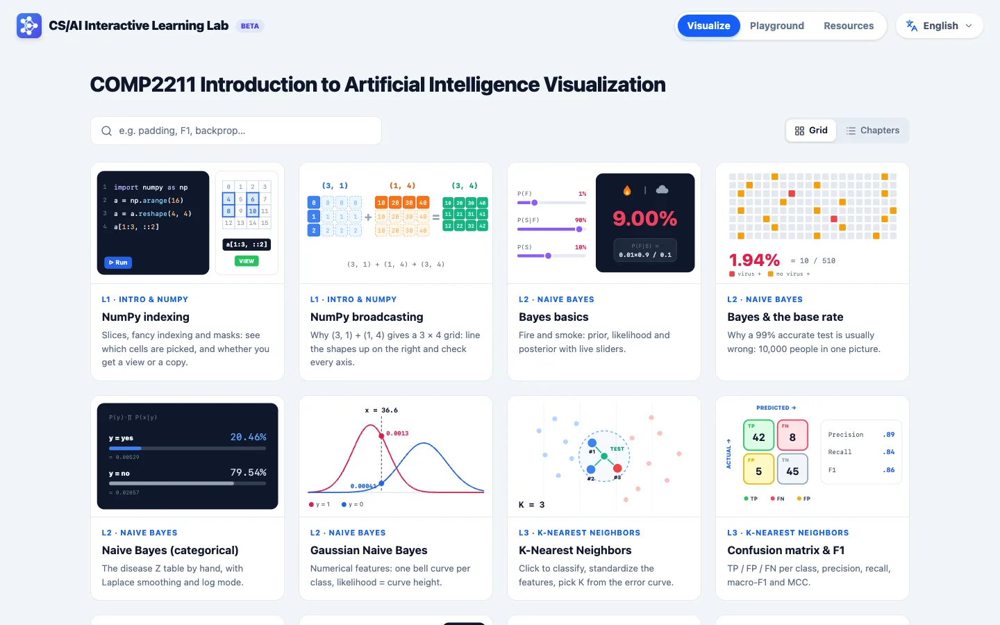
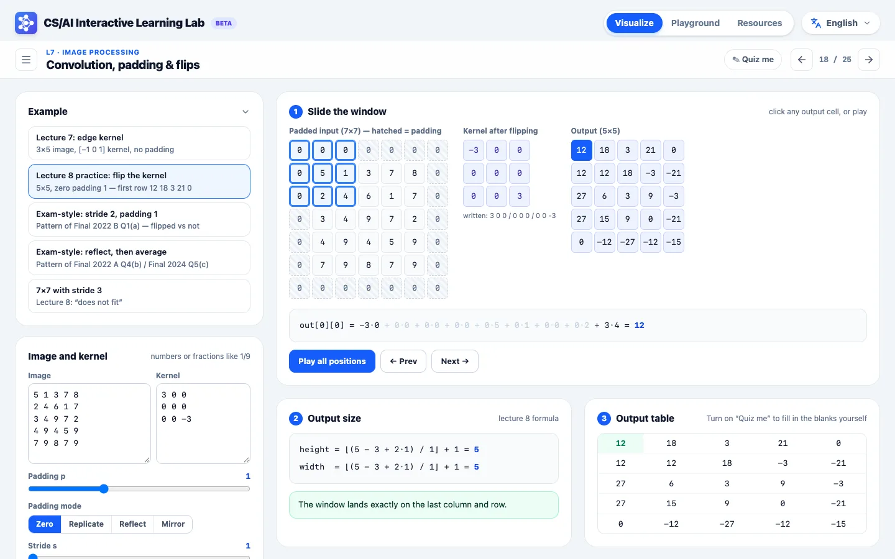
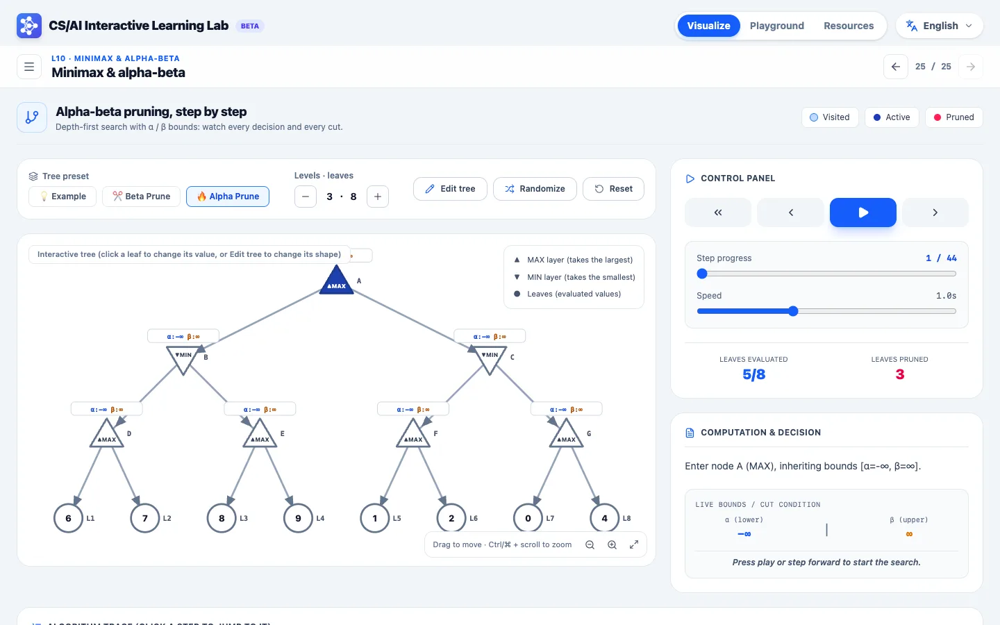
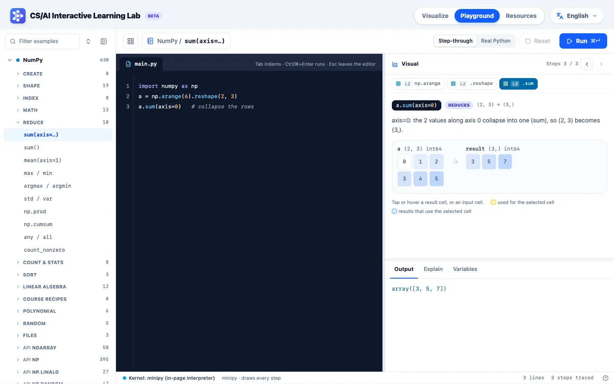

# KnowCS

[中文](./README_ZH.md) | **English**

[](https://knowcs.online)
[](./LICENSE)

**An interactive visual lab for HKUST COMP2211, Introduction to Artificial Intelligence.** Every lecture gets pages you can touch: drag a point, change a number, and watch the table the exam asks for fill itself in. Every number on screen is computed live, in your browser, by tested code.

**Live site:** <https://knowcs.online> in English, 简体中文 and 繁體中文 (`?lang=en`, `?lang=zh`, `?lang=zh-HK`).

[](https://knowcs.online)

<p>
  
  
  
</p>

## What is on the site

| Section | URL | What it does |
|---|---|---|
| Visualize | `/` | The course at a glance: one card per lab, grouped by lecture, with a search box. |
| Labs | `/<topic>/` | 25 hands-on pages. Most build the exact table an exam asks for, step by step, and have a “Quiz me” mode that blanks the cells for you to fill in. |
| Playground | `/playground/` | Python in the browser. Pick a library (NumPy, Matplotlib, pandas, scikit-learn, OpenCV, PyTorch, Keras, TensorFlow), edit the code, and every call becomes a step you can open: the array cells it used, the figure it drew, the layer shapes or the gradient graph. |
| Resources | `/resources/` | Sites worth keeping open next to the course. |

### Labs by lecture

| Lecture | Topic | Labs |
|---|---|---|
| 1 | Intro & NumPy | [NumPy indexing](https://knowcs.online/numpy/) · [NumPy broadcasting](https://knowcs.online/numpy-broadcast/) |
| 2 | Naive Bayes | [Bayes basics](https://knowcs.online/bayes-basics/) · [Bayes & the base rate](https://knowcs.online/bayes-virus/) · [Naive Bayes (categorical)](https://knowcs.online/naive-bayes/) · [Gaussian Naive Bayes](https://knowcs.online/gaussian-nb/) |
| 3 | K-Nearest Neighbors | [K-Nearest Neighbors](https://knowcs.online/knn/) · [Confusion matrix & F1](https://knowcs.online/evaluation/) · [D-fold cross-validation trap](https://knowcs.online/cross-validation/) |
| 4 | K-Means Clustering | [K-Means animation](https://knowcs.online/kmeans/) · [K-Means by hand](https://knowcs.online/kmeans-table/) |
| 5 | Neurons & Perceptron | [Perceptron learning table](https://knowcs.online/perceptron/) |
| 6 | Multilayer Perceptron | [Backpropagation](https://knowcs.online/backprop/) · [XOR & backprop by numbers](https://knowcs.online/xor-mlp/) · [How a network bends space](https://knowcs.online/nn-classify/) · [A network paints a picture](https://knowcs.online/nn-paint/) |
| 7 | Image Processing | [Edge-detection kernels](https://knowcs.online/kernel/) · [Convolution, padding & flips](https://knowcs.online/convolution/) · [Histogram, contrast & Otsu](https://knowcs.online/otsu/) · [Affine transforms & augmentation](https://knowcs.online/affine/) |
| 8 | Convolutional Networks | [CNN shapes & parameters](https://knowcs.online/cnn-shapes/) · [Inside a CNN, live](https://knowcs.online/cnn-live/) |
| 9 | PyTorch | [PyTorch](https://knowcs.online/pytorch/) · [Train a CNN on MNIST](https://knowcs.online/mnist/) |
| 10 | Minimax & Alpha-Beta | [Minimax & alpha-beta](https://knowcs.online/alphabeta/) |

The repository also holds sections that are switched off or not linked from the site at the moment: animated explainers (`/watch/`), a true/false concept check (`/drill/`), a formula sheet (`/formulas/`), an exam map (`/papers/`) and package notes (`/notes/`).

## Run it locally

```bash
npm install
npm run dev          # http://localhost:5174
npm run lint         # ESLint
npm test             # Vitest: calculations and components
npm run test:server  # the admin API’s own tests (server/)
npm run typecheck    # tsc --noEmit
npm run build        # multi-page build into dist/
```

The site is static: `npm run build` produces plain files that any web server can host. The only server-side part is a small optional Node service (`server/admin.mjs`) that stores the Resources list and anonymous visit counts.

## How it is built

- **Stack:** React 19, TypeScript (strict), Vite 7, Tailwind CSS 4, Framer Motion, KaTeX and react-i18next.
- **Pages:** a multi-page site. `src/lib/sitemap.ts` lists every page, and the build writes one HTML file per page.
- **Calculations:** everything a page shows is computed in `src/lib/`, with unit tests next to the code.
- **Text:** `src/locales/en.json` and `zh.json` are written by hand; `zh-HK.json` is generated with `npm run gen:zh-hk`.
- **Real Python:** the Playground can run your code in [Pyodide](https://pyodide.org/), loaded only on pages that need it.

Project conventions are in [CLAUDE.md](./CLAUDE.md); the change log and the plan are in [docs/](./docs/); deployment notes are in [deploy/](./deploy/README.md).

## Contributing

Contributions are welcome: a fix to a wrong number, a clearer explanation, a new lab, or a translation. Open an issue or a pull request.

The same approach should work for other courses. If you would like to take it to COMP1023 or beyond, please do, and get in touch if I can help.

## If something looks wrong

Parts of this site were built with Claude Code (Opus 5.5). KnowCS is a student project, not an official course site: where anything here differs from the lecture notes, the lecture notes are right. If you find a mistake, please [open an issue](https://github.com/OpenKnowit/KnowCS/issues) or write to <jzhangkb@connect.ust.hk>.

## People

KnowCS is an independent work project at HKUST.

<table>
  <tr>
    <td align="center" width="33%"><br /><b>Zhang Jiahao (Charles) 张嘉豪</b><br />Author<br />Year 3 COMP student, HKUST</td>
    <td align="center" width="33%"><br /><b>Dr. Desmond Tsoi</b><br />Supervisor</td>
    <td align="center" width="33%"><br /><b><a href="https://github.com/moyunxiang">Mo Yunxiang (Kevin) 莫云翔</a></b><br />Inspiration and help</td>
  </tr>
</table>

My deepest thanks go to **Dr. Desmond Tsoi** for his generous support and help. His encouragement is what made this project possible.

Thanks to **Mo Yunxiang (Kevin)** for inspiring this project and helping along the way. His [COMP2211 study notes](https://github.com/moyunxiang/COMP2211/blob/main/COMP2211.md) are where the early content started.

Thanks also to **Gray** (TA) for testing the site and giving feedback, to **Zhang Baiqiao** for advice on the interface, and to the members of the **COMP2211 teaching team** for their help.

If KnowCS helped you, a star on this repository would mean a lot.

## Built on

KnowCS stands on other people’s open-source work, for example:

- [ConvNetJS](https://cs.stanford.edu/people/karpathy/convnetjs/) by Andrej Karpathy: the neural networks in the live CNN, MNIST and classifier labs.
- [Dragology](https://declarative-dragging.github.io): declarative dragging for SVG, used for the points you drag in the K-Means lab.
- [Pyodide](https://pyodide.org/): CPython compiled to WebAssembly, which runs the real Python in the Playground.

Exam examples are paraphrased or recomputed from the course’s lectures and past papers for study use.

## License

The code is released under the [MIT License](./LICENSE). Third-party material keeps its own terms: ConvNetJS (`src/lib/vendor/convnet.js`, MIT) and the MNIST images (`src/data/mnist/`, CC BY-SA 3.0).
