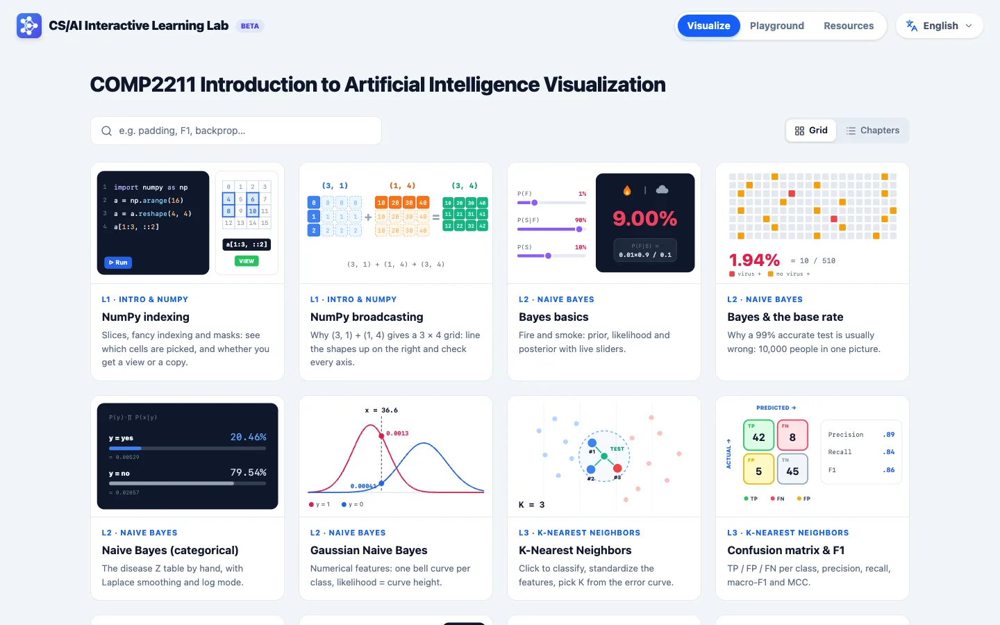
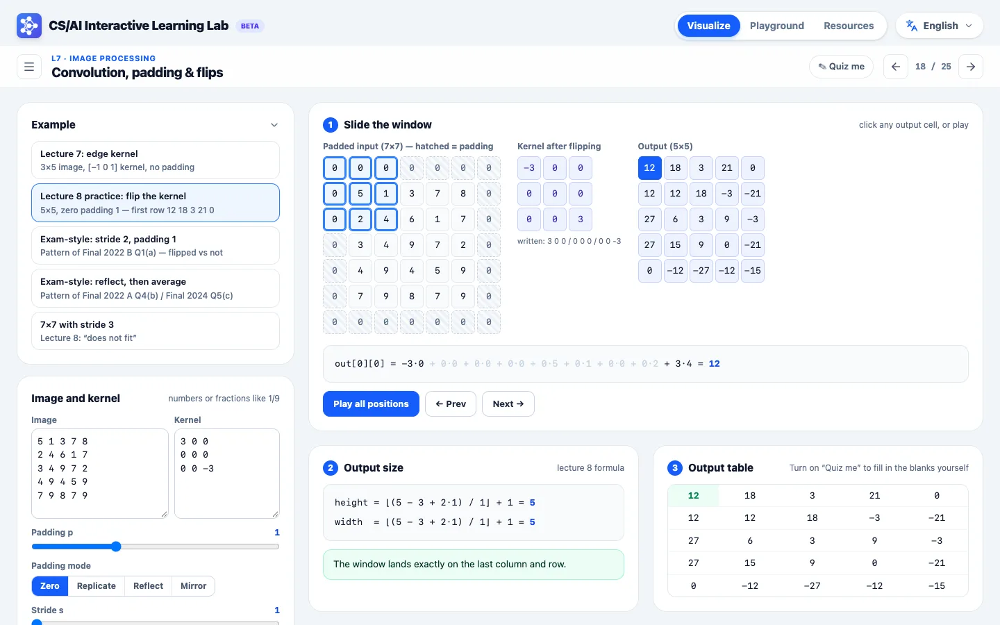
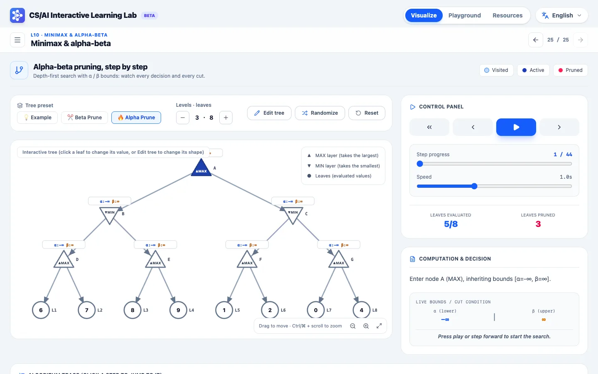
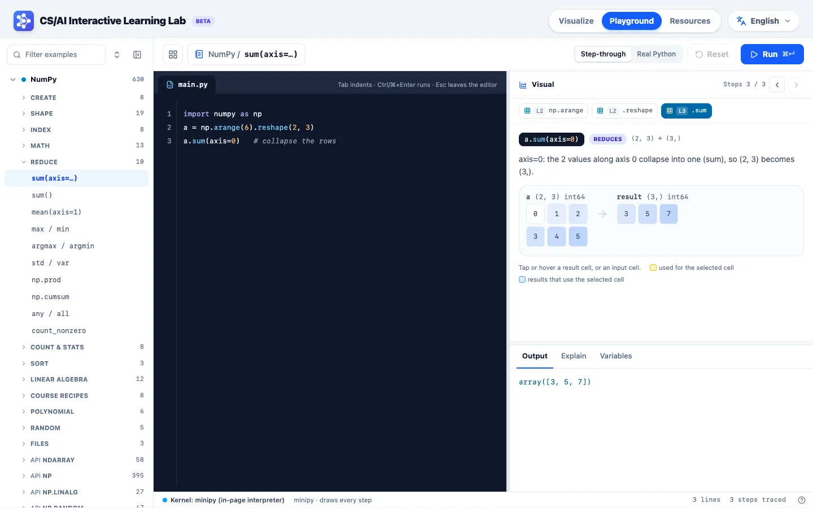

# KnowCS

**中文** | [English](./README.md)

[](https://knowcs.online)
[](./LICENSE)

**面向香港科技大学 COMP2211（Introduction to Artificial Intelligence，人工智能导论）的交互式可视化实验室。** 每一讲都有可以动手的页面：拖一个点、改一个数，考试要求的那张表就会自己填出来。画面上的每个数字都由经过测试的代码在浏览器里实时算出。

**在线访问：** <https://knowcs.online>，支持 English、简体中文、繁體中文（`?lang=en`、`?lang=zh`、`?lang=zh-HK`）。

[](https://knowcs.online)

<p>
  
  
  
</p>

## 网站内容

| 栏目 | 地址 | 内容 |
|---|---|---|
| 可视化 | `/` | 整门课一览：每个实验一张卡片，按讲次分组，可以搜索。 |
| 实验 | `/<主题>/` | 25 个动手页面。大多数会一步步算出考试要求的那张表，并有「自测」模式，把格子留空让你自己填。 |
| 实验场 | `/playground/` | 浏览器里的 Python。选一个库（NumPy、Matplotlib、pandas、scikit-learn、OpenCV、PyTorch、Keras、TensorFlow），修改代码，每次调用都会变成可以展开的一步：用到的数组格子、画出的图、各层形状或梯度图。 |
| 资源 | `/resources/` | 学这门课时值得一直开着的网站。 |
| 关于 | `/about/` | 谁做了这个网站、谁帮了忙，以及发现错误时怎么办。 |

### 各讲的实验

| 讲次 | 主题 | 实验 |
|---|---|---|
| 1 | 导论与 NumPy | [NumPy 索引](https://knowcs.online/numpy/) · [NumPy 广播](https://knowcs.online/numpy-broadcast/) |
| 2 | 朴素贝叶斯 | [贝叶斯基础](https://knowcs.online/bayes-basics/) · [贝叶斯与基础比率](https://knowcs.online/bayes-virus/) · [朴素贝叶斯（分类特征）](https://knowcs.online/naive-bayes/) · [高斯朴素贝叶斯](https://knowcs.online/gaussian-nb/) |
| 3 | K 近邻 | [K 近邻](https://knowcs.online/knn/) · [混淆矩阵与 F1](https://knowcs.online/evaluation/) · [D 折交叉验证陷阱](https://knowcs.online/cross-validation/) |
| 4 | K-Means 聚类 | [K-Means 动画](https://knowcs.online/kmeans/) · [手算 K-Means](https://knowcs.online/kmeans-table/) |
| 5 | 神经元与感知机 | [感知机学习表](https://knowcs.online/perceptron/) |
| 6 | 多层感知机 | [反向传播](https://knowcs.online/backprop/) · [XOR 与反向传播数值演算](https://knowcs.online/xor-mlp/) · [神经网络怎样弯曲空间](https://knowcs.online/nn-classify/) · [神经网络画画](https://knowcs.online/nn-paint/) |
| 7 | 图像处理 | [边缘检测卷积核](https://knowcs.online/kernel/) · [卷积、填充与翻转](https://knowcs.online/convolution/) · [直方图、对比度与 Otsu](https://knowcs.online/otsu/) · [仿射变换与数据增强](https://knowcs.online/affine/) |
| 8 | 卷积神经网络 | [CNN 形状与参数](https://knowcs.online/cnn-shapes/) · [实时看 CNN 内部](https://knowcs.online/cnn-live/) |
| 9 | PyTorch | [PyTorch](https://knowcs.online/pytorch/) · [在浏览器里训练 MNIST 卷积网络](https://knowcs.online/mnist/) |
| 10 | Minimax 与 Alpha-Beta | [Minimax 与 Alpha-Beta](https://knowcs.online/alphabeta/) |

仓库里还有一些暂时关闭或没有入口的栏目：动画讲解（`/watch/`）、判断题自测（`/drill/`）、公式表（`/formulas/`）、考点地图（`/papers/`）和资料包笔记（`/notes/`）。

## 本地运行

```bash
npm install
npm run dev          # http://localhost:5174
npm run lint         # ESLint
npm test             # Vitest: 计算与组件
npm run test:server  # 后台 API 自己的测试（server/）
npm run typecheck    # tsc --noEmit
npm run build        # 多页构建，输出到 dist/
```

网站是纯静态的：`npm run build` 产出的文件放到任何 Web 服务器上都能用。唯一的服务端部分是一个可选的小型 Node 服务（`server/admin.mjs`），用来保存资源列表和匿名访问计数。

## 实现方式

- **技术栈：** React 19、TypeScript（strict）、Vite 7、Tailwind CSS 4、Framer Motion、KaTeX、react-i18next。
- **页面：** 多页站点。`src/lib/sitemap.ts` 列出所有页面，构建时每个页面生成一个 HTML 文件。
- **计算：** 页面显示的所有内容都在 `src/lib/` 里计算，单元测试放在代码旁边。
- **文案：** `src/locales/en.json` 和 `zh.json` 手写；`zh-HK.json` 由 `npm run gen:zh-hk` 生成。
- **真实 Python：** 实验场可以用 [Pyodide](https://pyodide.org/) 运行你的代码，只在需要的页面加载。

项目约定见 [CLAUDE.md](./CLAUDE.md)，开发日志与规划见 [docs/](./docs/)，部署说明见 [deploy/](./deploy/README.md)。

## 参与贡献

欢迎任何贡献：改正一个算错的数、把一段解释写得更清楚、加一个新实验，或者补充翻译。直接提 issue 或 pull request 即可。

同样的做法应该也适用于其他课程。如果你想把它带到 COMP1023 或更多课程，欢迎动手，需要帮忙可以联系我。

## 如果发现不对的地方

本站有一部分是借助 Claude Code（Opus 5.5）构建的。KnowCS 是学生项目，不是课程官方网站：如果内容与课件不一致，请以课件为准。发现错误欢迎[提 issue](https://github.com/OpenKnowit/KnowCS/issues)，或者写信到 <jzhangkb@connect.ust.hk>。

## 成员

KnowCS 是香港科技大学的一个 COMP4971 Independent Work 项目，在 Desmond Tsoi 博士的指导下完成。它受到新加坡国立大学 [VisuAlgo](https://visualgo.net/) 和斯坦福 [CS231n](https://cs231n.stanford.edu/) 的启发，我想给 COMP2211 也做一个这样的网站。

<table>
  <tr>
    <td width="190"></td>
    <td>
      作者<br />
      <b>Zhang Jiahao (Charles) 张嘉豪</b><br />
      香港科技大学 COMP 三年级学生，KnowCS 的设计者和开发者。<br /><a href="mailto:jzhangkb@connect.ust.hk">jzhangkb@connect.ust.hk</a>
    </td>
  </tr>
</table>

**感谢**

<table>
  <tr>
    <td align="center" width="50%"><br /><b>Dr. Desmond Tsoi</b><br />指导老师</td>
    <td align="center" width="50%"><br /><b><a href="https://github.com/moyunxiang">Mo Yunxiang (Kevin) 莫云翔</a></b><br />启发、帮助与协助开发</td>
  </tr>
</table>

特别感谢 **Dr. Desmond Tsoi** 给予的大力支持和帮助。正是在他的鼓励下，这个项目才得以实现。

感谢 **Mo Yunxiang (Kevin)** 给这个项目带来的启发和帮助，并协助了一部分开发。

还要感谢助教 **Gray** 帮忙测试并提出反馈，感谢 **Zhang Baiqiao** 在界面设计上的建议，也感谢 **COMP2211 教学团队**各位成员的帮助。

如果 KnowCS 对你有帮助，欢迎给这个仓库点一个 Star。

## 用到的开源项目

KnowCS 建立在许多开源项目之上，例如：

- [ConvNetJS](https://cs.stanford.edu/people/karpathy/convnetjs/)（Andrej Karpathy）：实时 CNN、MNIST 和分类器这几个实验里的神经网络。
- [Dragology](https://declarative-dragging.github.io)：面向 SVG 的声明式拖拽库，K-Means 实验里拖动的点由它驱动。
- [Pyodide](https://pyodide.org/)：编译成 WebAssembly 的 CPython，实验场里的真实 Python 由它运行。

早期内容参考了 [moyunxiang/COMP2211](https://github.com/moyunxiang/COMP2211/blob/main/COMP2211.md) 的学习笔记。考试例题均依据课程讲义与往年试卷改写或重新计算，仅供学习使用。

## 许可

代码以 [MIT 许可](./LICENSE) 发布。第三方材料沿用各自的条款：ConvNetJS（`src/lib/vendor/convnet.js`，MIT）与 MNIST 图片（`src/data/mnist/`，CC BY-SA 3.0）。
